# Task & Goal

**Plan your days. Reach your goals.**

Task & Goal is a mobile app for planning tasks, timing the work you actually do on them, taking deliberate micro-breaks, and rolling everything up into long-term goals. It is built with **Expo (React Native) and TypeScript**, and talks to a **Node.js / Express / MongoDB** REST API secured with JWT.

The idea behind the app is simple: a to-do list tells you *what* to do, but not *how your day actually went*. Task & Goal adds a live stopwatch to every task, so each task builds a real history of work sessions and breaks, and goals fill up automatically as the linked tasks get done.

---

## Table of contents

- [Features](#features)
- [Screenshots](#screenshots)
- [Tech stack](#tech-stack)
- [How the app is built](#how-the-app-is-built)
- [Project structure](#project-structure)
- [Navigation map](#navigation-map)
- [Data model](#data-model)
- [How time tracking works](#how-time-tracking-works)
- [Backend API](#backend-api)
- [Getting started](#getting-started)
- [Building an Android APK](#building-an-android-apk)
- [Branches](#branches)
- [Design system](#design-system)
- [Known limitations](#known-limitations)
- [Decision log](#decision-log)
- [License](#license)

---

## Features

**Accounts**
- Register, log in and log out, with inline form validation and server error messages.
- The session (JWT + user) is saved on the device, so the app opens straight to Home on the next launch.
- Edit your name and email from the Profile tab.

**Tasks**
- Create a task with a title, description, priority, start date, optional end date and up to two tags.
- Make a task recurring: choose the weekdays it repeats on and a target number of days.
- Search tasks, filter them by status (All / Not Started / In Progress / Completed / Paused) and sort by date or priority.
- **Urgent task** shortcut: type just a title and start timing it immediately.

**Time tracking**
- Start, pause, resume and complete a task with a live timer.
- Only one thing can run at a time, across both tasks and breaks.
- Paused time is excluded from the recorded duration.
- Every task keeps an activity log: when it was created, each work session, each break taken, and when it was completed.

**Micro-breaks**
- Six built-in breaks (Coffee Break, Power Nap, Relax, Watch a Video, Short Walk, Quick Snack).
- Confirm or adjust the break length before starting, then watch a countdown ring while it runs.
- Take a **quick break** from a running task: the task session ends, the break starts, and when the break ends the task card shows a **Resume** button.
- Add your own breaks, and change the duration of the built-in ones.

**Goals**
- Create a goal with a name, colour, start date and target date.
- Link existing tasks to a goal and say how many times each task must be done.
- Progress is calculated live from the linked tasks. A goal is marked *achieved* automatically when it reaches 100%.
- Start a linked task directly from the goal screen.

**Calendar**
- Month view with previous/next navigation and a dot on every day that has work scheduled.
- Tap a day to see its tasks.

**Home dashboard**
- Today's remaining tasks, micro-breaks taken today, and active goals at a glance.
- Today's Tasks, Missed Tasks (overdue and not completed) and the micro-break grid.
- The currently running task or break is pinned to the top.

**Achievements**
- A completed task or an achieved goal is recorded as an achievement automatically.
- Tapping an achievement opens the full activity log behind it.

---

## Screenshots

### 1. Login

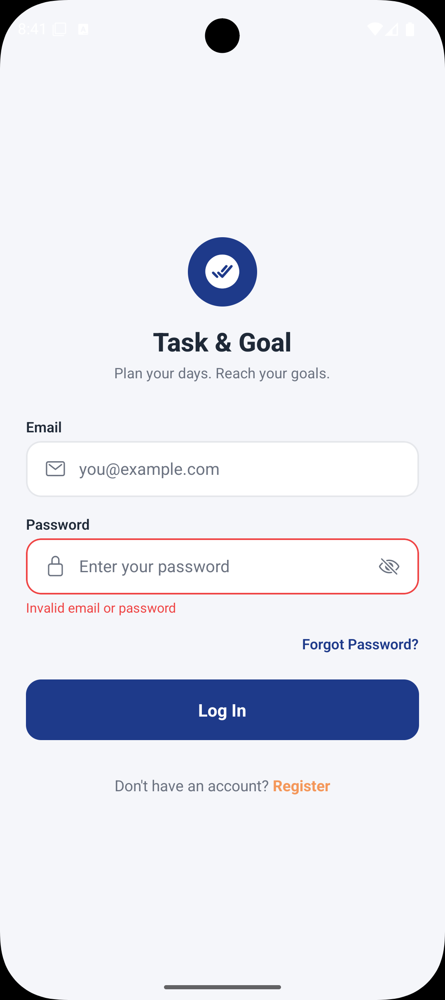

The first screen after the splash. It shows the app logo and tagline, email and password fields, a *Forgot Password?* link and a link to Register. The password field has a show/hide toggle. In this capture a wrong password was entered, so the field is outlined in red with the server's message, *Invalid email or password*, underneath.

### 2. Home (dashboard)

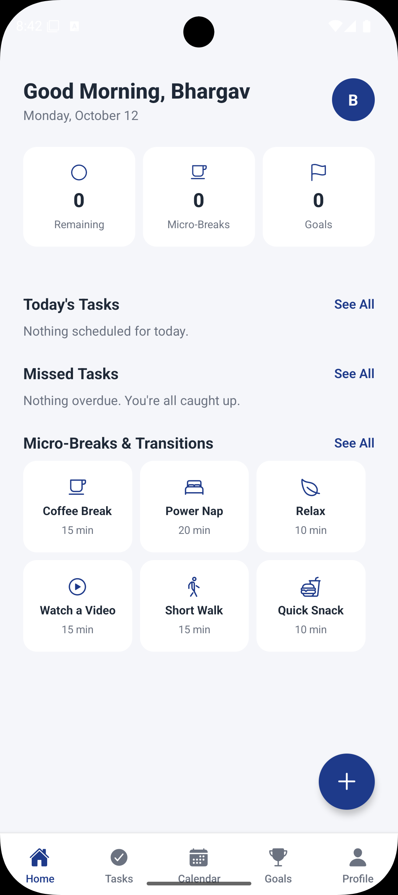

The Home tab greets the user by first name and shows today's date. The three cards count **remaining tasks for today**, **micro-breaks taken today** and **active goals**. Below them are **Today's Tasks**, **Missed Tasks** (days that were due earlier and never completed) and the **Micro-Breaks & Transitions** grid, where a single tap starts a break. The round **+** button opens the Add menu. The bottom bar holds the five tabs: Home, Tasks, Calendar, Goals and Profile.

### 3. Add menu

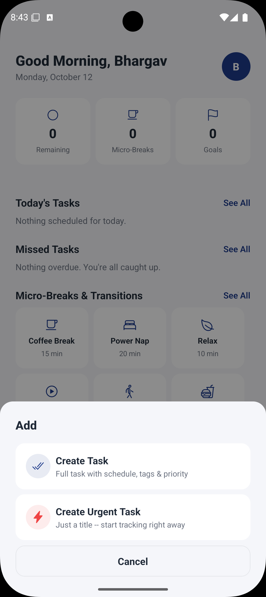

Tapping **+** on Home slides up a sheet with two choices. **Create Task** opens the full form with schedule, tags and priority. **Create Urgent Task** asks only for a title, creates a Critical-priority task for today and can start the timer straight away. If something else is running, it is stopped first.

### 4. Active task

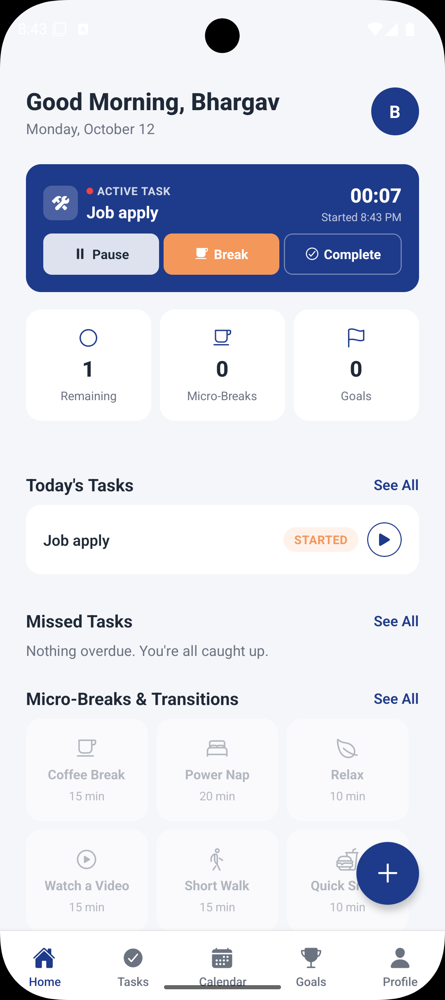

Once a task is being timed, an **Active Task** card is pinned to the top of Home with the task name, the time it started and a timer that ticks every second. Its three buttons are **Pause** (freeze the timer), **Break** (end this session and pick a micro-break) and **Complete**. The task also appears under Today's Tasks with a *Started* badge, and the micro-break grid is greyed out because only one session can run at a time.

### 5. Complete task confirmation

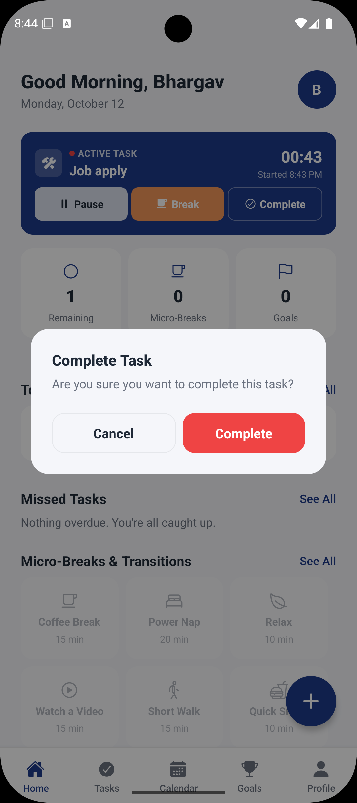

Completing a task is confirmed first, so a stray tap cannot end a session. Confirming stops the timer, saves the session to the task's activity log, marks the task and today's entry as completed, and records an achievement.

### 6. New task

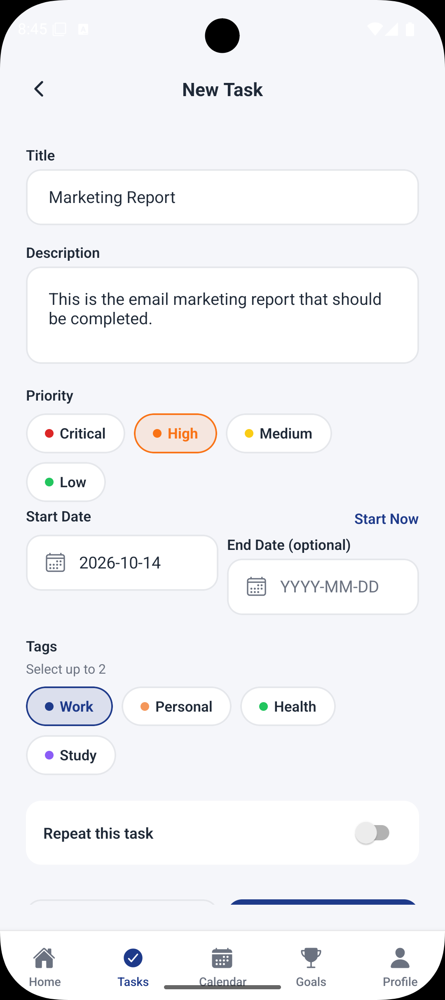

The full task form. **Priority** has no default and must be chosen. **Start Now** fills the start date with today. **End Date** is optional. Up to **two tags** can be selected. Switching on **Repeat this task** reveals the weekday picker and the target number of days. Status is not asked for here, because a new task always begins as *Not Started*.

### 7. Tasks

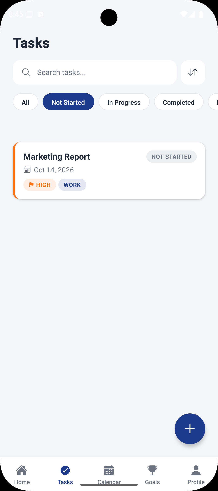

The Tasks tab lists every task, with a search box, a sort toggle (date or priority) and status filter chips. It opens on **Not Started**, as that is the list of work still to begin. Each card shows the title, start date and status, with a coloured stripe for the priority. The priority badge carries a flag icon (*High*) so that it cannot be confused with a tag badge (*Work*).

### 8. Calendar

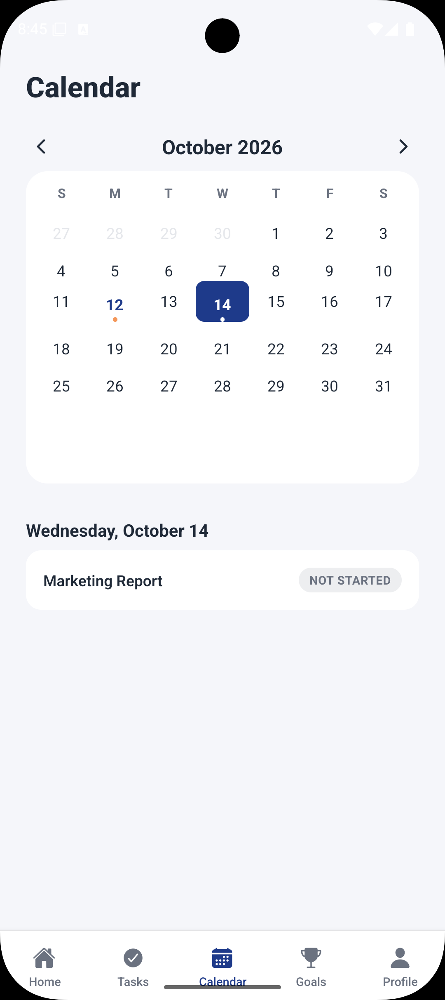

A month grid with arrows to move between months. Today is shown in blue, the selected day is filled in, and a dot marks each day that has a task scheduled. The tasks for the selected day are listed underneath with their status. Here the *Marketing Report* task created in the previous step appears on 14 October.

### 9. Goals

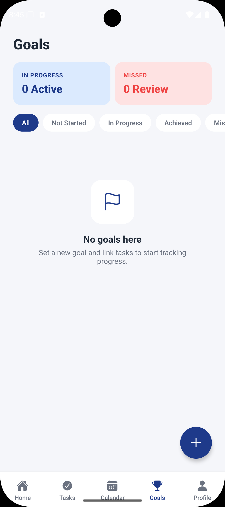

The Goals tab summarises how many goals are **in progress** and how many were **missed**, then lists them with status filters (All / Not Started / In Progress / Achieved / Missed). This capture shows the empty state for a new account. The **+** button opens the goal form, where tasks are linked to the goal.

### 10. Profile

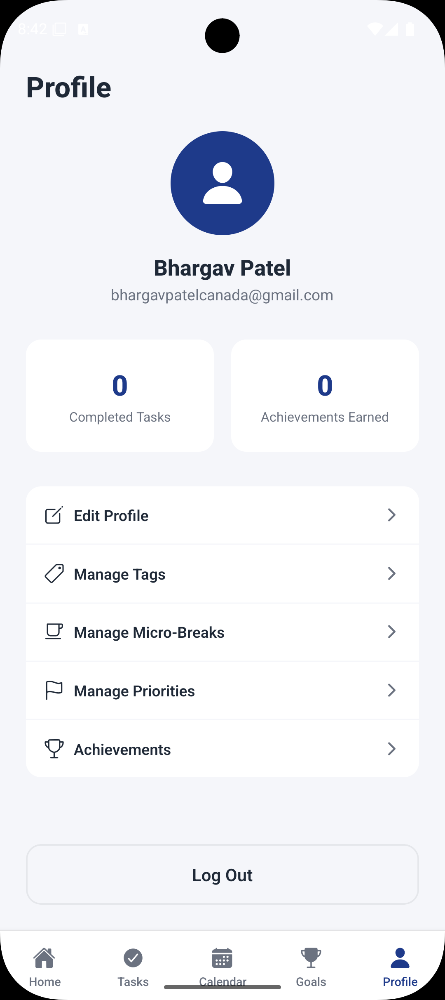

The Profile tab shows the user's name and email, the number of **completed tasks** and **achievements earned**, and the settings menu: Edit Profile, Manage Tags, Manage Micro-Breaks, Manage Priorities and Achievements. **Log Out** clears the saved session and returns to Login.

### 11. Manage tags

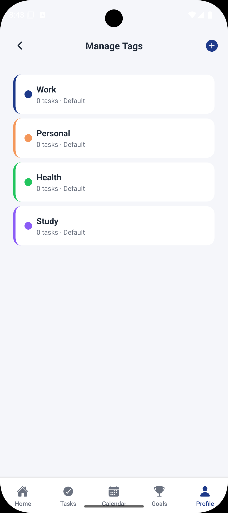

Tags group tasks by area of life. Every account starts with four default tags (Work, Personal, Health and Study), which are locked against editing and deletion. The **+** button adds a custom tag with its own name and colour, and custom tags can be edited or deleted. Each row shows how many tasks use the tag.

### 12. Manage micro-breaks

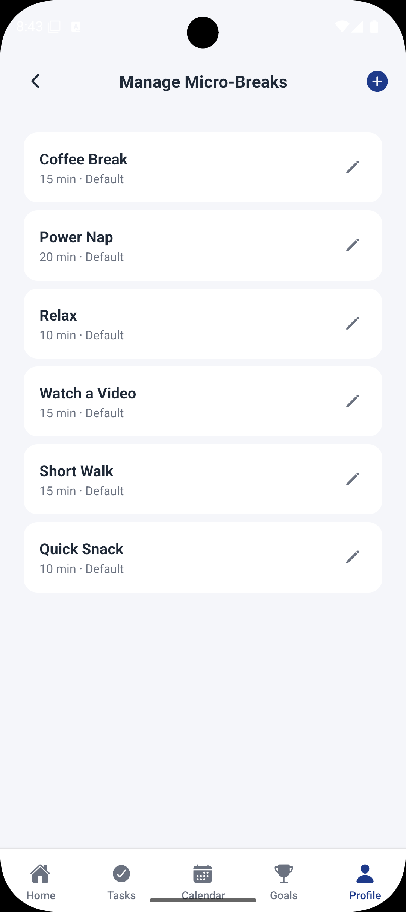

The list of breaks offered across the app. The six defaults can have their **duration** changed with the pencil icon, but they cannot be renamed or deleted. The **+** button adds a custom break, which can be fully edited and deleted.

### 13. Manage priorities

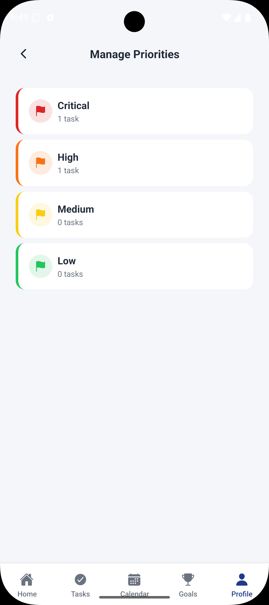

The four priority levels (Critical, High, Medium and Low) with their colours and the number of tasks at each level. Priorities are shared by all users. In this capture one task is Critical (the urgent task) and one is High (the Marketing Report).

---

## Tech stack

| Layer | Technology |
| --- | --- |
| Framework | Expo SDK 57, React Native 0.86, React 19 |
| Language | TypeScript 6 |
| Navigation | React Navigation 7 (native stack + bottom tabs) |
| State | React Context (`AuthContext`, `DataContext`), no external state library |
| Local storage | `@react-native-async-storage/async-storage` (saved session) |
| Icons | `@expo/vector-icons` (Ionicons) |
| Web support | `react-native-web` |
| Backend | Node.js 20+, Express 4, Mongoose 8, MongoDB |
| Auth | JWT (`jsonwebtoken`), passwords hashed with `bcryptjs` |
| Build and hosting | EAS Build (Android APK), Vercel (API) |

---

## How the app is built

```
App.tsx
└── SafeAreaProvider
    └── AuthProvider            who is logged in (token + user, saved to the device)
        └── DataProvider        all app data and every action that changes it
            └── NavigationContainer
                └── Root stack: Splash → Login / Register / ForgotPassword → Main (tabs)
```

- **`AuthContext`** owns the session. It loads the saved token on launch, and exposes login, register, logout and profile update.
- **`DataContext`** is the single source of truth for tasks, tags, priorities, micro-breaks, goals, task days, activity logs, daily activities and achievements. Screens never call the API themselves. They call an action such as `addTask`, `startTaskToday`, `pauseTracking`, `quickBreak` or `completeTask`, and the context calls the API and updates its state.
- **`src/api/client.ts`** is a thin `fetch` wrapper. It adds the `Authorization: Bearer <token>` header, turns failed responses into an `ApiError` with a readable message, and has one typed function per endpoint.
- **Screens** are presentation: they read from the contexts and render shared components.
- **The Splash screen** waits for both contexts to finish loading, then routes to Login or Main.

Because all data access sits behind `DataContext`, the app was first built on in-memory mock data and later connected to the real API without rewriting the screens.

---

## Project structure

```
task-goal-app/
├── App.tsx                  Root providers and the root stack
├── index.ts                 Expo entry point
├── app.json                 Expo configuration
├── eas.json                 EAS build profiles
├── .env                     EXPO_PUBLIC_API_URL (public API address)
├── DECISIONS.md             Log of every design decision and its reasoning
├── docs/screenshots/        Images used in this README
├── assets/                  App icon, splash and favicon
└── src/
    ├── api/client.ts        Typed REST client
    ├── config.ts            API base URL
    ├── theme.ts             Colours, spacing, radius, colour palette
    ├── types/models.ts      TypeScript types for every entity
    ├── context/             AuthContext, DataContext
    ├── navigation/          Tab navigator, one stack per tab, route types
    ├── hooks/               useElapsedSeconds (live timer tick)
    ├── utils/format.ts      Dates, durations, status labels, goal progress
    ├── data/                Break icon lookup
    ├── components/          Reusable UI
    │   ├── ActiveSessionSection   The running task / break card
    │   ├── AddTaskFab             "+" button and the Add sheet
    │   ├── BreakPresetGrid        Micro-break grid
    │   ├── BreakCountdownRing     Countdown ring for a running break
    │   ├── QuickBreakModal        Break picker for a running task
    │   ├── ConfirmDialog          Confirmation popup
    │   ├── TaskForm / GoalForm / TagForm / PriorityForm / MicroBreakForm
    │   ├── TaskCard / GoalCard / TaskStartButton
    │   └── Button, Input, DateInput, Badge, ChoiceChips, Stepper,
    │       ProgressBar, EmptyState, ScreenHeader, Logo
    └── screens/             One file per screen (see the navigation map)
```

---

## Navigation map

Each bottom tab owns its own stack, so a tab can push detail screens without affecting the others. Pressing a tab returns it to its root screen.

```
Root stack
├── Splash
├── Login
├── Register
├── ForgotPassword
└── Main (bottom tabs)
    ├── Home      → Dashboard → Today (today's tasks and breaks)
    ├── Tasks     → Tasks list → Task detail → Task days → Activity logs
    │                          → Add task / Edit task
    │                          → Task activity log
    ├── Calendar  → Calendar
    ├── Goals     → Goals list → Goal detail → Edit goal
    │                          → Add goal
    │                          → Goal activity log
    └── Profile   → Profile → Edit profile
                            → Manage tags → Create / Edit tag
                            → Manage micro-breaks → Create / Edit micro-break
                            → Manage priorities
                            → Achievements
```

---

## Data model

The types in [`src/types/models.ts`](src/types/models.ts) mirror the MongoDB collections one for one.

| Entity | What it is | Key fields |
| --- | --- | --- |
| **User** | An account | `name`, `email` |
| **Priority** | Urgency level, shared by all users | `name`, `color` |
| **Tag** | Per-user category | `name`, `color`, `is_default` |
| **MicroBreak** | Per-user break preset | `title`, `duration_minutes`, `is_default` |
| **Task** | A piece of work | `title`, `priority_id`, `tag_ids[]`, `start_date`, `end_date`, `status`, `recurrence_target_days`, `recurrence_completed_days` |
| **TaskRecurrence** | A weekday a task repeats on | `task_id`, `day_name` |
| **TaskDay** | One scheduled day of a task | `task_id`, `day_date`, `status`, `rating`, `review` |
| **ActivityLog** | One timed work session on a task day | `task_day_id`, `start_time`, `end_time`, `duration_minutes`, `daily_activity_id` |
| **DailyActivity** | One break or other logged activity | `title`, `start_time`, `end_time`, `duration_minutes` |
| **Goal** | A long-term target | `name`, `color`, `start_date`, `target_date`, `status` |
| **GoalTask** | Link between a goal and a task | `goal_id`, `task_id`, `no_of_times_task` |
| **Achievement** | A recorded completion | `achievement_type`, `reference_id`, `title`, `achieved_at` |

How they relate:

```
User ─┬─ Tag
      ├─ MicroBreak
      ├─ DailyActivity
      ├─ Achievement
      ├─ Task ─┬─ TaskRecurrence
      │        └─ TaskDay ── ActivityLog ──(optional)── DailyActivity
      └─ Goal ── GoalTask ── Task
Priority (global) ── Task
```

Status values:

- **Task**: `not_started`, `in_progress`, `completed`, `paused`
- **TaskDay**: `not_started`, `started`, `completed`, `missed`
- **Goal**: `not_started`, `in_progress`, `achieved`, `missed`
- **Achievement type**: `task_completed`, `recurrence_completed`, `goal_achieved`

Two values are calculated rather than stored:

- **Goal progress** is worked out from the linked tasks: how many times each one has been completed, against the number of times the goal requires.
- **Total tracked time** for a task is the sum of `duration_minutes` over its activity logs.

---

## How time tracking works

- **A running session is a row with no end time.** A task session is an `ActivityLog` with no `end_time`. A break is a `DailyActivity` with no `end_time`. No extra "is running" flag is stored.
- **One session at a time.** `runningSession()` in `DataContext` looks across both kinds and returns the one that is open, if any. Every start action checks it first, so the rule holds no matter which screen starts the session.
- **Starting a task** reuses today's `TaskDay` if the task has one, or creates it, then opens an `ActivityLog` on it and sets the task to `in_progress`.
- **The live timer** comes from the `useElapsedSeconds` hook. It re-renders once a second from the session's start time, and nothing is written to the server until the session ends.
- **Pause and resume** are tracked on the device. The app adds up the paused time and subtracts it when the session ends, then sends the true active minutes to the API. The stored `start_time` always stays the real start time.
- **Quick break** ends the task session and starts the chosen break in one action, and links the break to that session through `daily_activity_id`, so the task's activity log can show where the break fell.
- **Completing a task** ends the open session, marks today's `TaskDay` and the task as completed, records a `task_completed` achievement, and checks every linked goal. A goal that has now reached 100% is set to `achieved` and gets its own achievement.

---

## Backend API

The API lives in a separate repository: [BhargavRaseshPatel/Task-and-Schedular-backend](https://github.com/BhargavRaseshPatel/Task-and-Schedular-backend). It is layered as **routes → controllers → services → models**. Every route except auth and health requires a JWT, and every query is scoped to the logged-in user, so one user can never read or change another user's data.

| Area | Endpoints |
| --- | --- |
| Health | `GET /api/health` |
| Auth | `POST /api/auth/register`, `POST /api/auth/login`, `PATCH /api/auth/me` |
| Priorities | `GET`, `POST /api/priorities`, `PATCH /api/priorities/:id` |
| Tags | `GET`, `POST /api/tags`, `PATCH`, `DELETE /api/tags/:id` |
| Micro-breaks | `GET`, `POST /api/micro-breaks`, `PATCH`, `DELETE /api/micro-breaks/:id` |
| Tasks | `GET`, `POST /api/tasks`, `PATCH`, `DELETE /api/tasks/:id` |
| Recurrences | `GET`, `POST /api/tasks/:taskId/recurrences`, `DELETE .../recurrences/:id` |
| Task days | `GET`, `POST /api/tasks/:taskId/days`, `PATCH .../days/:dayId` |
| Activity logs | `GET`, `POST /api/tasks/:taskId/days/:dayId/logs`, `PATCH .../logs/:logId/stop` |
| Daily activities | `GET`, `POST /api/daily-activities`, `PATCH /api/daily-activities/:id/stop` |
| Goals | `GET`, `POST /api/goals`, `PATCH`, `DELETE /api/goals/:id` |
| Goal tasks | `GET`, `POST /api/goals/:goalId/tasks`, `PATCH`, `DELETE .../tasks/:id` |
| Achievements | `GET`, `POST /api/achievements` |

New accounts are seeded with the four default tags and the six default micro-breaks at registration.

---

## Getting started

### Requirements

- Node.js 20.19.4 or newer (22 LTS recommended)
- npm
- One of: Android Studio emulator, Xcode iOS Simulator, the Expo Go app on a phone, or just a web browser

### 1. Install and run the app

```bash
git clone https://github.com/BhargavRaseshPatel/task-goal-app.git
```

```bash
cd task-goal-app
```

```bash
npm install
```

```bash
npx expo start
```

Then press `a` for Android, `i` for iOS or `w` for web, or scan the QR code with Expo Go. The same targets are available as scripts:

| Script | What it does |
| --- | --- |
| `npm start` | Start the Expo dev server |
| `npm run android` | Start and open on Android |
| `npm run ios` | Start and open on iOS |
| `npm run web` | Start and open in the browser |

### 2. Point the app at an API

The API address is read from `EXPO_PUBLIC_API_URL` (see [`src/config.ts`](src/config.ts)), falling back to `http://localhost:5050/api`.

To use your own backend, create a `.env.local` file in the project root. It is git-ignored and overrides `.env`:

```
EXPO_PUBLIC_API_URL=http://localhost:5050/api
```

`localhost` only works for the web build and the iOS Simulator. On the Android emulator use `http://10.0.2.2:5050/api`, and on a real phone use your computer's LAN address, for example `http://192.168.1.20:5050/api`.

Anything prefixed with `EXPO_PUBLIC_` is compiled into the app and is readable by anyone who has it, so never put a secret in these files.

### 3. Run the backend locally (optional)

```bash
git clone https://github.com/BhargavRaseshPatel/Task-and-Schedular-backend.git
```

```bash
cd Task-and-Schedular-backend
```

```bash
npm install
```

Copy `.env.example` to `.env` and set `MONGODB_URI`, `JWT_SECRET` and `PORT` (the app expects `5050`), then:

```bash
npm run dev
```

---

## Building an Android APK

The project is configured for [EAS Build](https://docs.expo.dev/build/introduction/) with three profiles in `eas.json`: `development` (dev client), `preview` (installable APK for testing) and `production` (APK with an auto-incremented version).

```bash
npx eas-cli build --platform android --profile preview
```

The Android package name is `com.bhargavpatel.taskgoalapp`.

---

## Branches

| Branch | State |
| --- | --- |
| `main` | Checkpoint of the full UI running on **in-memory mock data**. Only login and register call the API. Data is lost when the app restarts. |
| `real-backend-integration` | The app shown in the screenshots above. Everything is saved through the API. Adds micro-break management, the break countdown, Missed Tasks, task and goal activity logs, automatic achievements, real dates, and the EAS and `.env` configuration. |

Parts of this README that describe API-backed data, `eas.json`, `.env`, Manage Micro-Breaks, Missed Tasks and the activity log screens apply to `real-backend-integration`.

---

## Design system

Defined in [`src/theme.ts`](src/theme.ts):

| Token | Value | Used for |
| --- | --- | --- |
| `primary` | `#1E3A8A` | Buttons, active tab, headers, the active task card |
| `accent` | `#F4975A` | Break button, *Started* badge, the Register link |
| `success` | `#22C55E` | Completed and achieved states |
| `warning` | `#FACC15` | Paused indicator |
| `danger` | `#EF4444` | Errors, overdue dates, destructive confirmation |
| `background` | `#F5F6FA` | Screen background |
| `card` | `#FFFFFF` | Cards and inputs |

Spacing runs on a 4 / 8 / 16 / 24 / 32 scale, and corner radii are 8 / 14 / 20. Tags, priorities and goals pick their colour from a shared ten-colour palette. The app is portrait-only and uses a light theme.

---

## Known limitations

- **Forgot Password is a screen only.** It shows a confirmation message, but no reset email is sent, because the backend has no email service yet.
- **No native date picker.** On web the date fields use the browser's date picker. On Android and iOS dates are typed as `YYYY-MM-DD`.
- **Pause is tracked on the device.** If the app is closed while a task is paused, the paused time is not remembered.
- **The greeting is fixed.** Home always says "Good Morning", whatever the time of day.
- **Tasks and goals cannot be deleted from the app.** The API supports it, but there is no button for it yet.
- **Priorities are view-only** in the app; the add and edit screens are not linked from Manage Priorities.
- **No offline mode and no push notifications.** The app needs a connection to load and save data.
- **No automated test suite.** Changes were verified by hand and with one-off scripts.

---

## Decision log

[`DECISIONS.md`](DECISIONS.md) records every significant choice made while building the app, with the reasoning, the bugs found along the way and how each change was verified. Read it to understand why something works the way it does.

---

## License

MIT. See [`LICENSE`](LICENSE).
